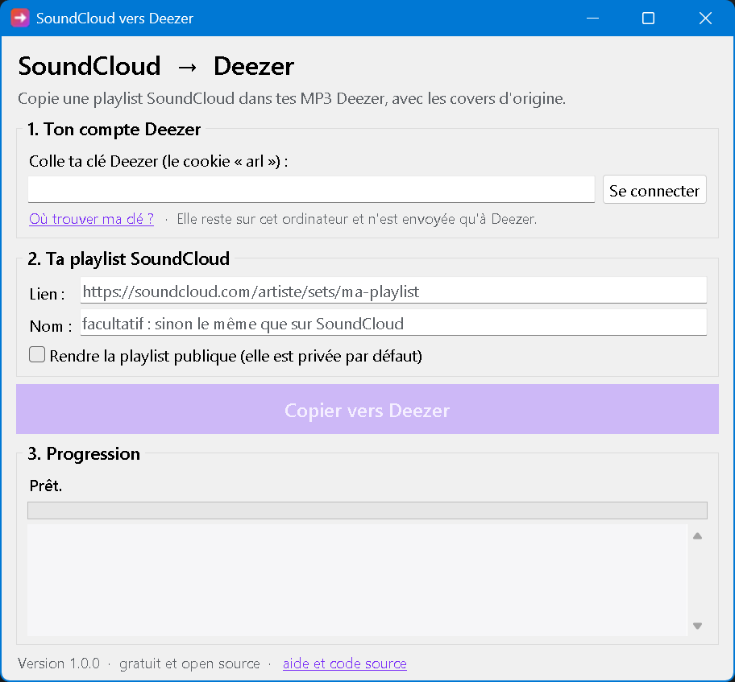

<p align="center">
  
</p>

<h1 align="center">SoundCloud → Deezer</h1>

<p align="center">
  Copie une playlist SoundCloud sur ton compte Deezer, avec les covers d'origine.<br>
  Gratuit, open source, rien à installer.
</p>

<p align="center">
  <a href="https://github.com/tomspf2009-prog/soundcloud-to-deezer/releases/latest"><b>⬇️ Télécharger pour Windows</b></a>
  &nbsp;·&nbsp;
  <a href="#english">English</a>
</p>

<p align="center">
  
</p>

## Ce que ça fait

Tu colles le lien d'une playlist SoundCloud, tu cliques sur un bouton, et le programme :

1. télécharge les sons de la playlist ;
2. les ajoute à **tes MP3** sur Deezer (la fonction « Mes MP3 » de Deezer), chacun avec sa cover ;
3. crée une **playlist privée** sur Deezer, avec la même cover que sur SoundCloud.

Tu retrouves ensuite ta playlist dans Deezer, sur ordinateur comme sur téléphone. Les sons ne sont visibles et écoutables que par toi.

Ça marche avec **Deezer Gratuit, Premium et Famille** (avec Famille, tu choisis ton profil).

## Mode d'emploi

### 1. Télécharger le programme

Va sur la [dernière version](https://github.com/tomspf2009-prog/soundcloud-to-deezer/releases/latest) et télécharge **SoundCloud-vers-Deezer.exe**. Double-clique dessus : il n'y a rien à installer.

> **Windows affiche « Windows a protégé votre ordinateur » ?** C'est normal pour un petit programme gratuit : pour faire disparaître ce message, il faut acheter un certificat de signature, qui coûte plusieurs centaines d'euros par an. Clique sur **Informations complémentaires**, puis sur **Exécuter quand même**. Pour savoir pourquoi tu peux lui faire confiance, lis [Sécurité et confidentialité](#sécurité-et-confidentialité).

### 2. Connecter ton compte Deezer

Le programme te demande ta **clé Deezer**. Il en a besoin pour ajouter les sons à ton compte, car Deezer ne propose pas d'autre moyen. Elle se trouve en une minute : voir [Trouver ma clé Deezer](#trouver-ma-clé-deezer).

Si ton abonnement est **Famille**, choisis ensuite **ton** profil dans la liste : les MP3 ne pourront être écoutés que sur ce profil.

### 3. Copier ta playlist

Sur SoundCloud, ouvre ta playlist et copie son lien (barre d'adresse, ou « Partager » puis « Copier le lien »). Colle-le dans le programme et clique sur **Copier vers Deezer**.

Compte quelques secondes par son. Tu peux fermer le programme à tout moment : relance la même playlist plus tard, elle reprendra là où elle s'était arrêtée.

## Trouver ma clé Deezer

La clé Deezer est un code que Deezer enregistre dans ton navigateur quand tu te connectes (un « cookie » appelé `arl`). Comme un mot de passe, elle permet d'utiliser ton compte : **ne la donne à personne**. Le programme la garde uniquement sur ton ordinateur.

Sur ordinateur, avec Chrome, Edge ou Firefox :

1. Va sur [deezer.com](https://www.deezer.com) et connecte-toi.
2. Appuie sur la touche **F12**. Un panneau s'ouvre : c'est normal, tu ne risques rien.
3. En haut de ce panneau, clique sur l'onglet **Application** (Chrome, Edge) ou **Stockage** (Firefox). Tu ne le vois pas ? Clique sur **»** au bout des onglets.
4. À gauche, ouvre **Cookies**, puis clique sur `https://www.deezer.com`.
5. Tape `arl` dans la case **Filtrer**.
6. Double-clique sur la valeur de la ligne `arl` (une longue suite de lettres et de chiffres), puis fais **Ctrl+C**.
7. Reviens dans le programme et colle-la avec **Ctrl+V** (ou clic droit > Coller).

Le programme vérifie la clé tout de suite et affiche « ✓ » si elle fonctionne. Les clés finissent par expirer : si un jour elle ne marche plus, recopie-la de la même façon.

## Sécurité et confidentialité

- **Le code est public.** Tout le monde peut lire exactement ce que fait le programme, ligne par ligne.
- **Le .exe est fabriqué par GitHub**, automatiquement, à partir de ce code public (onglet [Actions](https://github.com/tomspf2009-prog/soundcloud-to-deezer/actions)), et pas sur l'ordinateur de quelqu'un. Chaque version est accompagnée de son empreinte `SHA256.txt`.
- **Ta clé Deezer reste chez toi.** Elle est enregistrée uniquement sur ton ordinateur (dans `%APPDATA%\soundcloud-to-deezer`) et n'est envoyée qu'à Deezer. Le bouton « Changer de compte » l'efface.
- **Aucun intermédiaire.** Le programme ne parle qu'à SoundCloud et à Deezer : pas de serveur à nous, pas de statistiques, pas de publicité.
- **Il ne supprime rien.** Il ajoute des MP3 et crée une playlist, c'est tout.
- **Antivirus.** Certains antivirus se méfient par erreur des programmes faits avec l'outil utilisé ici (PyInstaller). En cas de doute, vérifie l'empreinte SHA-256, ou utilise la [version Python](#pour-les-curieux-et-les-développeurs).

## Questions fréquentes

**Ça marche avec un compte Deezer gratuit ?**
Oui.

**Certains sons sont marqués « protégé (DRM) ».**
SoundCloud protège certains sons, souvent ceux des maisons de disques. Ils ne peuvent pas être téléchargés : le programme les passe et copie les autres.

**La playlist SoundCloud a de nouveaux sons.**
Relance la copie avec le même lien : seuls les nouveaux sons sont ajoutés, sans doublons.

**Où sont les MP3 téléchargés ?**
Dans ton dossier `Musique\SoundCloud vers Deezer`. Une fois sur Deezer, tu peux les supprimer si tu veux (ils seront retéléchargés si tu mets la playlist à jour).

**Y a-t-il une limite ?**
Deezer accepte jusqu'à 2 000 MP3 perso, de 200 Mo maximum chacun.

**Et sur Mac ou Linux ?**
Il n'y a pas encore d'application prête à l'emploi. La [version Python](#pour-les-curieux-et-les-développeurs) fonctionne.

**Ça ne marche plus.**
Deezer et SoundCloud changent parfois leurs sites. Télécharge la dernière version ; si le problème continue, [signale-le ici](https://github.com/tomspf2009-prog/soundcloud-to-deezer/issues) en décrivant ce qui s'affiche.

## Droits d'auteur

Cet outil sert à écouter sur Deezer des sons que tu as le droit de télécharger : sons proposés en téléchargement libre, tes propres morceaux, ou avec l'accord de l'artiste. Il ne contourne aucune protection (les sons protégés sont ignorés), et les MP3 restent privés sur ton compte. Respecte le travail des artistes.

Projet indépendant, sans lien avec Deezer ni SoundCloud.

## Pour les curieux et les développeurs

Il faut Python 3.10 ou plus récent. Le plus simple est [pipx](https://pipx.pypa.io) :

```
pipx install git+https://github.com/tomspf2009-prog/soundcloud-to-deezer
sc2deezer                     # ouvre la fenêtre
sc2deezer <lien SoundCloud>   # version ligne de commande
```

Options de la ligne de commande : `--profil <prénom>` (offre Famille), `--nom`, `--publique`, `--dossier`, `--changer-cle`, `--oublier-cle`. La clé peut aussi être fournie par la variable d'environnement `DEEZER_ARL`.

Comment ça marche :

- **SoundCloud** : [yt-dlp](https://github.com/yt-dlp/yt-dlp) lit la playlist et télécharge l'audio, converti en MP3 256 kbit/s à débit constant (ce que recommande Deezer) avec le ffmpeg fourni par `imageio-ffmpeg`. [mutagen](https://github.com/quodlibet/mutagen) écrit le titre, l'artiste et la cover dans chaque MP3.
- **Deezer** : il n'existe pas d'API officielle pour les MP3 perso. Le programme fait les mêmes requêtes que le site deezer.com : `upload.deezer.com` pour envoyer les MP3 et la cover, et l'API interne `gw-light.php` pour créer la playlist et changer de profil Famille. Elles peuvent changer sans prévenir.
- **Reprise** : l'avancement est noté dans `state.json`, à côté des MP3, profil par profil.

Le code est dans [`sc2deezer/`](sc2deezer). Les contributions sont bienvenues.

## English

**SoundCloud → Deezer** copies a SoundCloud playlist into your Deezer account as personal MP3s ("My MP3s"), keeping each track's artwork, and creates a private Deezer playlist with the original SoundCloud cover. It works with Free, Premium and Family plans (you pick your profile).

[Download the Windows app](https://github.com/tomspf2009-prog/soundcloud-to-deezer/releases/latest), or run `pipx install git+https://github.com/tomspf2009-prog/soundcloud-to-deezer` on any OS. The app needs your Deezer `arl` cookie (see the steps above: F12 > Application > Cookies > `arl`). The cookie is stored only on your computer and only sent to Deezer. DRM-protected SoundCloud tracks are skipped. Only use it for tracks you are allowed to download.

## Licence

[GPL-3.0-or-later](LICENSE).
