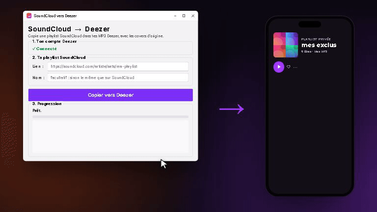
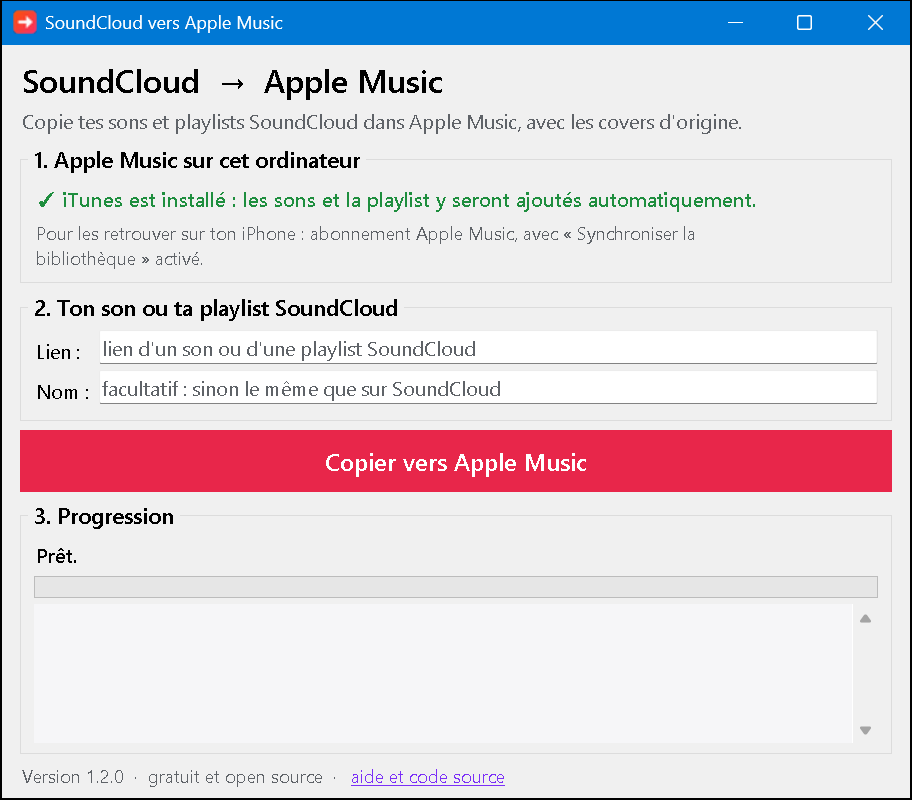

<p align="center">
  
  &nbsp;&nbsp;
  
</p>

<h1 align="center">SoundCloud → Deezer · Apple Music</h1>

<p align="center">
  Copie tes sons et playlists SoundCloud dans Deezer ou Apple Music, avec les covers d'origine.<br>
  Gratuit, open source, rien à installer.
</p>

<p align="center">
  <a href="https://github.com/tomspf2009-prog/soundcloud-to-deezer/releases/latest/download/SoundCloud-vers-Deezer.exe"><b>⬇️ Pour Deezer</b></a>
  &nbsp;·&nbsp;
  <a href="https://github.com/tomspf2009-prog/soundcloud-to-deezer/releases/latest/download/SoundCloud-vers-Apple-Music.exe"><b>⬇️ Pour Apple Music</b></a>
  &nbsp;·&nbsp;
  <a href="#english">English</a>
</p>

<p align="center">
  
</p>

## Ce que ça fait

Tu colles le lien d'une **playlist** SoundCloud (ou d'**un seul son**), tu cliques sur un bouton, et le programme télécharge les sons, garde **la cover de chacun**, puis les range sur ta plateforme dans une playlist. Relance le même lien plus tard : seuls les nouveaux sons sont ajoutés.

## Choisis ta plateforme

| | 🟣 Deezer | 🔴 Apple Music |
|---|---|---|
| **Programme** | [SoundCloud-vers-Deezer.exe](https://github.com/tomspf2009-prog/soundcloud-to-deezer/releases/latest/download/SoundCloud-vers-Deezer.exe) | [SoundCloud-vers-Apple-Music.exe](https://github.com/tomspf2009-prog/soundcloud-to-deezer/releases/latest/download/SoundCloud-vers-Apple-Music.exe) |
| **Où vont les sons** | Dans tes MP3 Deezer (« Mes MP3 ») et une playlist privée | Dans ta bibliothèque iTunes ou Apple Music, et une playlist |
| **Ce qu'il te faut** | Un compte Deezer (même gratuit) | iTunes ou l'appli Apple Music sur ton PC Windows |
| **Sur ton téléphone** | Oui, tout de suite | Oui avec un abonnement Apple Music (voir le tuto) |
| **Liker automatiquement** | Oui (Coups de cœur) | Non |
| **Tuto** | [Tuto Deezer](#tuto-deezer) | [Tuto Apple Music](#tuto-apple-music) |

---

## Tuto Deezer

### 1. Télécharger le programme

Télécharge **[SoundCloud-vers-Deezer.exe](https://github.com/tomspf2009-prog/soundcloud-to-deezer/releases/latest/download/SoundCloud-vers-Deezer.exe)** et double-clique dessus : il n'y a rien à installer.

> **Windows affiche « Windows a protégé votre ordinateur » ?** C'est normal pour un petit programme gratuit : pour faire disparaître ce message, il faut acheter un certificat de signature, qui coûte plusieurs centaines d'euros par an. Clique sur **Informations complémentaires**, puis sur **Exécuter quand même**. Pour savoir pourquoi tu peux lui faire confiance, lis [Sécurité et confidentialité](#sécurité-et-confidentialité).

<p align="center">
  
</p>

### 2. Connecter ton compte Deezer

Le programme te demande ta **clé Deezer**. Il en a besoin pour ajouter les sons à ton compte, car Deezer ne propose pas d'autre moyen. Elle se trouve en une minute : voir [Trouver ma clé Deezer](#trouver-ma-clé-deezer).

Si ton abonnement est **Famille**, choisis ensuite **ton** profil dans la liste : les MP3 ne pourront être écoutés que sur ce profil.

### 3. Copier une playlist ou un son

Sur SoundCloud, ouvre la playlist (ou le son) et copie son lien (barre d'adresse, ou « Partager » puis « Copier le lien »). Colle-le dans le programme et clique sur le gros bouton violet.

- Pour **un seul son**, la case « Ajouter à mes Coups de cœur » se coche toute seule : décoche-la si tu veux juste l'ajouter à tes MP3.
- Pour **une playlist**, coche cette case si tu veux aussi liker tous ses sons.

Compte quelques secondes par son. Tu peux fermer le programme à tout moment : relance le même lien plus tard, la copie reprendra là où elle s'était arrêtée.

### 4. Ajouter les nouvelles exclus

Quand une nouvelle exclu sort dans la playlist SoundCloud, relance la copie avec **le même lien** : seuls les nouveaux sons sont téléchargés et ajoutés à la fin de la même playlist Deezer, sans doublons.

### Trouver ma clé Deezer

La clé Deezer est un code que Deezer enregistre dans ton navigateur quand tu te connectes (un « cookie » appelé `arl`). Comme un mot de passe, elle permet d'utiliser ton compte : **ne la donne à personne**. Le programme la garde uniquement sur ton ordinateur.

Sur ordinateur, avec Chrome, Edge ou Firefox :

1. Va sur [deezer.com](https://www.deezer.com) et connecte-toi.
2. Appuie sur la touche **F12**. Un panneau s'ouvre : c'est normal, tu ne risques rien.
3. En haut de ce panneau, clique sur l'onglet **Application** (Chrome, Edge) ou **Stockage** (Firefox). Tu ne le vois pas ? Clique sur **»** au bout des onglets.
4. À gauche, ouvre **Cookies**, puis clique sur `https://www.deezer.com`.
5. Tape `arl` dans la case **Filtrer**.
6. Double-clique sur la valeur de la ligne `arl` (une longue suite de lettres et de chiffres), puis fais **Ctrl+C**.
7. Reviens dans le programme et colle-la avec **Ctrl+V** (ou clic droit > Coller).

Le programme vérifie la clé tout de suite et affiche « ✓ » si elle fonctionne. Les clés finissent par expirer : si un jour elle ne marche plus, recopie-la de la même façon.

---

## Tuto Apple Music

Apple ne permet à aucun programme d'envoyer de la musique directement dans ta bibliothèque en ligne. Tout passe donc par le logiciel d'Apple installé sur ton PC : **iTunes** ou **l'appli Apple Music**. Pas besoin de clé ni de mot de passe.

### 0. Avant de commencer

**Il te faut iTunes ou l'appli Apple Music sur ton PC Windows.** Si tu n'as ni l'un ni l'autre, installe **Apple Music** depuis le Microsoft Store.

| Tu as… | Ce que fait le programme |
|---|---|
| **iTunes** | Tout est **automatique** : les sons et la playlist apparaissent dans iTunes. |
| **L'appli Apple Music** | Le programme prépare un **dossier à importer** en quelques clics (voir l'étape 4B). |

> Si tu as les deux, c'est l'appli Apple Music qui gère ta musique (Apple désactive alors la musique dans iTunes) : suis l'étape 4B.

**Pour retrouver les sons sur ton iPhone**, il faut un **abonnement Apple Music** et activer la synchronisation de la bibliothèque, une seule fois :

- **Dans iTunes** : menu **Édition > Préférences**, onglet **Général**, coche **« Bibliothèque musicale iCloud »**.
- **Dans l'appli Apple Music** : bouton **« Actions de la barre latérale »** (en haut de la barre latérale) **> Réglages > Général**, active **« Synchroniser la bibliothèque »**.
- **Sur l'iPhone** : **Réglages > Musique** (ou **Réglages > Apps > Musique**), active **« Synchroniser la bibliothèque »**.

Sans abonnement, les sons restent sur ton PC. Tu peux quand même les mettre sur ton iPhone en le branchant au PC et en le synchronisant avec iTunes ou l'app « Appareils Apple ».

### 1. Télécharger le programme

Télécharge **[SoundCloud-vers-Apple-Music.exe](https://github.com/tomspf2009-prog/soundcloud-to-deezer/releases/latest/download/SoundCloud-vers-Apple-Music.exe)** et double-clique dessus : il n'y a rien à installer. (Message « Windows a protégé votre ordinateur » : **Informations complémentaires > Exécuter quand même**, comme expliqué [plus haut](#1-télécharger-le-programme).)

### 2. Vérifier ce que le programme a trouvé

<p align="center">
  
</p>

En haut de la fenêtre, le programme te dit ce qu'il a trouvé sur ton PC :

- « ✓ iTunes est installé… » : tout sera automatique (étape 4A).
- « Le programme prépare un dossier de MP3… » : tu importeras ce dossier dans l'appli Apple Music (étape 4B).

### 3. Coller le lien et lancer

Sur SoundCloud, copie le lien de la playlist (ou du son), colle-le dans le programme, donne un nom à la playlist si tu veux, puis clique sur le gros bouton.

### 4A. Avec iTunes : c'est fini

iTunes s'ouvre et les sons y arrivent un par un, avec leur cover, dans une playlist au nom de la playlist SoundCloud (rubrique **Playlists** à gauche). Un son seul va directement dans ta bibliothèque.

> **Ne supprime pas** le dossier `Musique\SoundCloud vers Deezer` : iTunes lit les sons à cet endroit. Sauf si tu as coché, dans **Édition > Préférences > Avancé**, **« Copier dans le dossier iTunes Media les fichiers ajoutés à la bibliothèque »** : iTunes garde alors sa propre copie.

### 4B. Avec l'appli Apple Music : importer le dossier

À la fin, le programme **ouvre tout seul le dossier à importer** (dans `Musique\SoundCloud vers Deezer\Pour Apple Music`). Il contient les MP3 avec leurs covers et des noms lisibles, plus la cover de la playlist.

1. **Importer les sons** : dans l'appli Apple Music, clique sur le bouton **« Actions de la barre latérale »** (en haut de la barre latérale), puis **Importer**. Choisis le dossier que le programme vient d'ouvrir, puis **Ouvrir**. Plus simple : **glisse le dossier** depuis l'Explorateur de fichiers dans la fenêtre d'Apple Music.
2. **Créer la playlist** : clique sur le bouton d'ajout à côté de **Playlists** dans la barre latérale, puis **Nouvelle playlist**. Donne-lui un titre. Pour l'illustration, choisis le fichier **« cover de la playlist »** du dossier. Clique sur **Créer**.
3. **Remplir la playlist** : dans ta bibliothèque, sélectionne les sons que tu viens d'importer et **glisse-les sur la playlist** dans la barre latérale.

> **Garde le dossier** : par défaut, Apple Music lit les sons à cet endroit, sans les copier. Pour qu'il garde sa propre copie, active **« Copier dans le dossier multimédia les fichiers ajoutés à la bibliothèque »** dans **« Actions de la barre latérale » > Réglages > Fichiers**, avant d'importer.

Pour un **son seul**, le programme sélectionne le MP3 dans l'Explorateur : glisse-le dans Apple Music.

### 5. Ajouter les nouvelles exclus

Relance la copie avec **le même lien** :

- **iTunes** : seuls les nouveaux sons sont ajoutés, à la fin de la playlist. Rien d'autre à faire.
- **Appli Apple Music** : le programme crée un nouveau dossier (« 2 - ajout du … ») qui ne contient **que les nouveaux sons**. Importe-le comme à l'étape 4B, puis glisse ces sons sur ta playlist.

---

## Sécurité et confidentialité

- **Le code est public.** Tout le monde peut lire exactement ce que fait le programme, ligne par ligne.
- **Les .exe sont fabriqués par GitHub**, automatiquement, à partir de ce code public (onglet [Actions](https://github.com/tomspf2009-prog/soundcloud-to-deezer/actions)), et pas sur l'ordinateur de quelqu'un. Chaque version est accompagnée de leurs empreintes `SHA256.txt`.
- **Ta clé Deezer reste chez toi.** Elle est enregistrée uniquement sur ton ordinateur (dans `%APPDATA%\soundcloud-to-deezer`) et n'est envoyée qu'à Deezer. Le bouton « Changer de compte » l'efface. La version Apple Music n'en a pas besoin.
- **Aucun intermédiaire.** Le programme ne parle qu'à SoundCloud, et à Deezer ou à iTunes sur ton PC : pas de serveur à nous, pas de statistiques, pas de publicité.
- **Il ne supprime rien.** Il ajoute des sons et crée des playlists, c'est tout.
- **Antivirus.** Certains antivirus se méfient par erreur des programmes faits avec l'outil utilisé ici (PyInstaller). En cas de doute, vérifie l'empreinte SHA-256, ou utilise la [version Python](#pour-les-curieux-et-les-développeurs).

## Questions fréquentes

**Certains sons sont marqués « protégé (DRM) ».**
SoundCloud protège certains sons, souvent ceux des maisons de disques. Ils ne peuvent pas être téléchargés : le programme les passe et copie les autres.

**Où sont les MP3 téléchargés ?**
Dans ton dossier `Musique\SoundCloud vers Deezer` (les sons ajoutés un par un sont dans `Sons seuls`, ceux prêts pour l'appli Apple Music dans `Pour Apple Music`). Avec **Deezer**, tu peux les supprimer une fois copiés : une mise à jour ne retélécharge que les nouveaux sons. Avec **Apple Music**, garde-les (voir le tuto).

**Deezer : ça marche avec un compte gratuit ?**
Oui. Deezer accepte jusqu'à 2 000 MP3 perso, de 200 Mo maximum chacun.

**Deezer : j'ajoute un son seul qui est déjà dans une playlist copiée.**
Pas de doublon : le programme le reconnaît, ne le retélécharge pas, et se contente de le liker si la case est cochée.

**Apple Music : je n'ai pas d'abonnement.**
Le programme fonctionne quand même : les sons et la playlist sont sur ton PC. Pour l'iPhone, branche-le et synchronise-le avec iTunes ou l'app « Appareils Apple ».

**Et sur Mac ?**
Il n'y a pas encore d'application prête à l'emploi. La [version Python](#pour-les-curieux-et-les-développeurs) fonctionne : avec `--vers apple`, elle prépare le dossier à importer dans l'app Musique (**Fichier > Importer**).

**Ça ne marche plus, ou ce que je vois ne correspond pas au tuto.**
Deezer, SoundCloud et Apple changent parfois leurs logiciels. Télécharge la dernière version ; si le problème continue, [signale-le ici](https://github.com/tomspf2009-prog/soundcloud-to-deezer/issues) en décrivant ce qui s'affiche.

## Droits d'auteur

Cet outil sert à écouter sur ta plateforme des sons que tu as le droit de télécharger : sons proposés en téléchargement libre, tes propres morceaux, ou avec l'accord de l'artiste. Il ne contourne aucune protection (les sons protégés sont ignorés), et les sons restent privés. Respecte le travail des artistes.

Projet indépendant, sans lien avec Deezer, SoundCloud ni Apple.

## Pour les curieux et les développeurs

Il faut Python 3.10 ou plus récent. Le plus simple est [pipx](https://pipx.pypa.io) :

```
pipx install git+https://github.com/tomspf2009-prog/soundcloud-to-deezer
sc2deezer                     # ouvre la fenêtre (choix Deezer / Apple Music)
sc2deezer <lien SoundCloud>   # version ligne de commande
```

Options de la ligne de commande : `--vers apple` (Apple Music au lieu de Deezer), `--profil <prénom>` (offre Famille), `--coeur` / `--sans-coeur` (Coups de cœur ; automatique pour un son seul), `--nom`, `--publique`, `--dossier`, `--changer-cle`, `--oublier-cle`. La clé peut aussi être fournie par la variable d'environnement `DEEZER_ARL`.

Comment ça marche :

- **SoundCloud** : [yt-dlp](https://github.com/yt-dlp/yt-dlp) lit la playlist et télécharge l'audio, converti en MP3 256 kbit/s à débit constant avec le ffmpeg fourni par `imageio-ffmpeg`. [mutagen](https://github.com/quodlibet/mutagen) écrit le titre, l'artiste et la cover dans chaque MP3.
- **Deezer** : il n'existe pas d'API officielle pour les MP3 perso. Le programme fait les mêmes requêtes que le site deezer.com : `upload.deezer.com` pour envoyer les MP3 et la cover, et l'API interne `gw-light.php` pour créer la playlist, liker et changer de profil Famille. Elles peuvent changer sans prévenir.
- **Apple Music** : iTunes pour Windows se pilote par COM (`pywin32`) ; l'appli Apple Music ne se pilote pas, d'où le dossier à importer.
- **Reprise** : l'avancement est noté dans `state.json`, à côté des MP3, plateforme par plateforme.

Le code est dans [`sc2deezer/`](sc2deezer). Les deux .exe sont le même programme, lancé par [`launcher.py`](launcher.py) (Deezer) ou [`launcher_apple.py`](launcher_apple.py) (Apple Music). Les contributions sont bienvenues.

La vidéo de présentation et l'animation ci-dessus sont, elles aussi, faites en code avec [Remotion](https://www.remotion.dev) : voir [`promo/`](promo) (`npm install`, puis `npm run studio` pour les voir et les modifier, `npm run video` / `npm run gif` pour les exporter).

## English

**SoundCloud → Deezer · Apple Music** copies SoundCloud playlists (or single tracks) to your music platform, keeping each track's artwork:

- **Deezer** ([download](https://github.com/tomspf2009-prog/soundcloud-to-deezer/releases/latest/download/SoundCloud-vers-Deezer.exe)): tracks go to your personal MP3s ("My MP3s") and a private playlist with the original SoundCloud cover; single tracks can be added to your Favourite tracks. Works with Free, Premium and Family plans. It needs your Deezer `arl` cookie (F12 > Application > Cookies > `arl`), stored only on your computer and only sent to Deezer.
- **Apple Music** ([download](https://github.com/tomspf2009-prog/soundcloud-to-deezer/releases/latest/download/SoundCloud-vers-Apple-Music.exe)): with iTunes, tracks and the playlist are imported automatically; with the Apple Music app, a ready-to-import folder is prepared. An Apple Music subscription with Sync Library is needed to get them on your iPhone.

DRM-protected SoundCloud tracks are skipped. Only use it for tracks you are allowed to download.

## Licence

[GPL-3.0-or-later](LICENSE).
